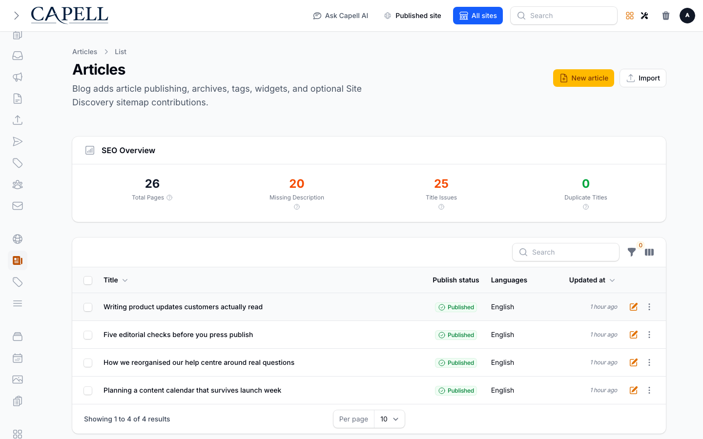
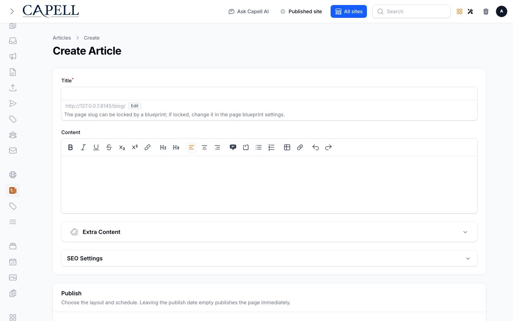

# Blog

<!-- prettier-ignore-start -->

Someone at a small firm or charity, writing the news on top of everything else, can write next Thursday's post today, date it for Thursday and go on leave. The post stays out of your blog until that date and then shows up by itself, with no button to press on the day. With page caching it still appears within a minute of that date.

Setting it up is a short job for whoever looks after your website. It creates the blog page, a page for each month's posts and a page for each tag, for every site and language you run. Tags are how posts are grouped, since there are no separate categories. Each author gets a page listing the posts they wrote, and their email address never appears on it. Readers who follow blogs through an app that gathers new posts receive your latest 20 as short summaries with a link back. The app picks up a new post the next time it checks.

Months later, a reader after your spring news can open April's page for every post from that month, or click a tag to see everything on one subject.

- **Price and availability:** Check current availability and price on the [Capell Marketplace listing](https://capell.app/extensions/blog).
- **Licence:** Check the licence terms on the [Capell Marketplace listing](https://capell.app/extensions/blog).
- **Requires:** `PHP ^8.4`, `capell-app/admin ^1.0.66`, `capell-app/content-sections ^1.0`, `capell-app/core ^1.0.78`, `capell-app/discovery-foundation ^1.0`, `capell-app/frontend ^1.0.72`, `capell-app/html-cache ^1.0`, `capell-app/layout-builder ^1.0`, `capell-app/tags ^1.0`, `capell-app/theme-foundation ^1.0`.
- **Install:** `composer require capell-app/blog`.

## Quick Start

1. Install the package: `composer require capell-app/blog`.
2. Run the package setup: `php artisan capell:blog-install`.
3. See it working: run `php artisan capell:blog-demo`.
4. Open the package admin surface at `/admin/blog/article` and confirm Blog is available.

## For Developers

Blog registers the article page type, configurators, feed routes, and render-data Actions as package extension points instead of adding article behaviour to core.

## Configure

- **Commands:** `php artisan capell:blog-create-pages`, `php artisan capell:blog-demo`, `php artisan capell:blog-faker`, `php artisan capell:blog-install`, `php artisan capell:blog-setup`, `php artisan capell:hero-demo`.

## Limits And Pitfalls

- Install `capell-app/layout-builder` before Blog so its page types and widgets can register against the required editor surface.
- Run migrations before opening package resources or public routes.
- Keep the host Laravel scheduler running so package-registered schedules can execute: `Capell\Blog\Manifest\BlogScheduleContribution (everyMinute; manifest declared)`.
- Keep public Blade and cached HTML free of authoring markers, model IDs, permissions, signed editor URLs, and lazy database queries.
- Custom write integrations must preserve invalidation for `blog` cache tags.

## Screens And Workflow

- Articles admin index (admin).
- Create/edit article form (admin).
- Blog page frontend output (frontend).
- Archive page frontend output (frontend).
- Tag page frontend output (frontend).
- Articles admin index with admin sidebar menu open (admin).

## Works With

- [Comments](../comments/README.md): optional integration backed by the interop evidence map.
- [Navigation](../navigation/README.md): optional integration backed by the interop evidence map.
- [Insights](../insights/README.md): optional integration backed by the interop evidence map.
- [Publishing Studio](../publishing-studio/README.md): optional integration backed by the interop evidence map.
- [Search](../search/README.md): optional integration backed by the interop evidence map.
- [Site Discovery](../site-discovery/README.md): optional integration backed by the interop evidence map.
- [Url Manager](../url-manager/README.md): optional integration backed by the interop evidence map.

## Install Impact

- Required packages: `capell-app/admin`, `capell-app/content-sections`, `capell-app/core`, `capell-app/discovery-foundation`, `capell-app/frontend`, `capell-app/html-cache`, `capell-app/layout-builder`, `capell-app/tags`, `capell-app/theme-foundation`.
- Admin navigation: declares `admin-resource: BlogAdminResourcesContribution`; each Filament page or resource controls its own navigation visibility.
- Admin/editor extensions: `configurator: BlogConfiguratorsContribution`.
- Permissions: `ViewAny:Article`, `View:Article`, `Create:Article`, `Update:Article`, `Delete:Article`, `DeleteAny:Article`, `Restore:Article`, `RestoreAny:Article`, `ForceDelete:Article`, `ForceDeleteAny:Article`, `Replicate:Article`, `Reorder:Article`, `ViewAny:Tag`, `View:Tag`, `Create:Tag`, `Update:Tag`, `Delete:Tag`, `DeleteAny:Tag`, `Restore:Tag`, `RestoreAny:Tag`, `ForceDelete:Tag`, `ForceDeleteAny:Tag`, `Replicate:Tag`, `Reorder:Tag`; permission contributions: `Capell\Blog\Manifest\BlogPermissionsContribution`; Shield-generated widget permissions for `Capell\Blog\Filament\Widgets\ListArticlesFilamentWidget` (names and grants depend on host Shield configuration); access also governed by package policies: `ArticlePolicy`.
- Public routes: registers `BlogRoutesContribution`.
- Database changes: package migrations are declared.
- Config: no package config files.
- Settings: no package settings declared.
- Queues or schedules: scheduled commands `Capell\Blog\Manifest\BlogScheduleContribution (everyMinute; manifest declared)`.
- Cache tags: `blog`.
- Commands: `capell:blog-create-pages`, `capell:blog-demo`, `capell:blog-faker`, `capell:blog-install`, `capell:blog-setup`, `capell:hero-demo`.

## Troubleshooting

| Symptom | Likely cause | Check | Fix |
| --- | --- | --- | --- |
| Package surface is missing after install | Provider or manifest is not loaded | Confirm `capell.json`, package `composer.json`, and provider registration | Reinstall the package, refresh Composer autoload, and clear host caches |
| Admin screen or command fails on missing table | Package migrations have not run | Check the tables listed in `Data Model` | Run host migrations and rerun the focused package test |
| Background work does not run | Queue worker or declared schedule is not active | Check the jobs and scheduled commands listed in `Technical Shape` | Start the queue worker or host scheduler, then run the focused command or package test |
| Public output leaks unexpected state | Render data, cache variation, or authoring boundary has regressed | Check public Blade, cache tags, and public-output safety tests | Move data loading out of Blade and rerun the package public-output tests |

## Upgrading

No manual steps between minor versions.

Read [CHANGELOG.md](CHANGELOG.md) before upgrading.

## Next Steps

- [Package docs](docs/README.md)
- [Overview](docs/overview.md)
- [Worked extension examples](docs/extension-contracts.md)
- [Admin guide](docs/admin-guide.md)
- [Troubleshooting](#troubleshooting)
- [Developer reference](docs/reference.md)
- [Marketplace assets](docs/assets/marketplace/)
- [Capell content language plan](../../docs/CONTENT_LANGUAGE_PLAN.md)
- [Capell documentation design system](../../docs/DESIGN_SYSTEM.md)
- [Capell and package ERD notes](../../docs/erd/capell-and-package-erds.md)
- Related packages: [Content Sections](../content-sections/README.md), [Discovery Foundation](../discovery-foundation/README.md), [HTML Cache](../html-cache/README.md), [Layout Builder](../layout-builder/README.md), [Tags](../tags/README.md), [Foundation Theme](../theme-foundation/README.md), [Comments](../comments/README.md), [Navigation](../navigation/README.md), [Insights](../insights/README.md), [Publishing Studio](../publishing-studio/README.md), [Search](../search/README.md), [Site Discovery](../site-discovery/README.md), [Redirects](../url-manager/README.md).

<!-- prettier-ignore-end -->
